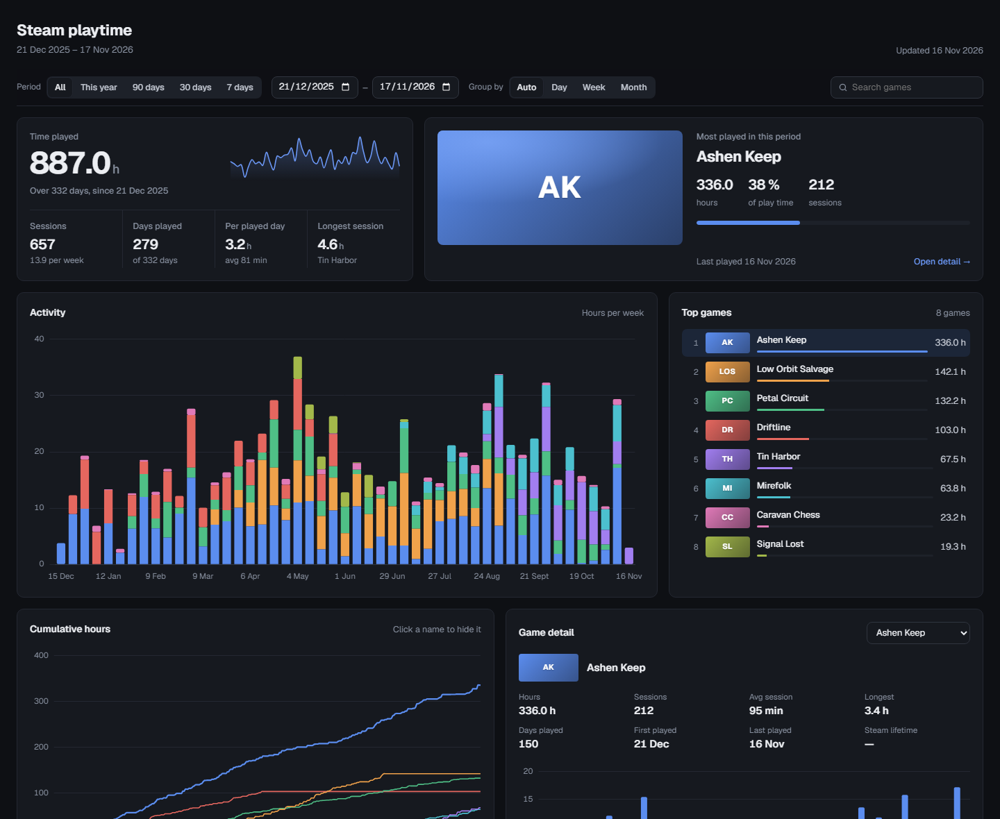

# steam-playtime

**English** · [Español](README.es.md)

See how your Steam play time evolves, game by game. `steam-playtime` reads the session log that the Steam client already keeps on your computer and turns it into an interactive HTML report:

- **Hours per week**, stacked by game
- **Cumulative hours** for your most played games
- **Daily detail** for any game you pick
- **A table** with total hours, number of sessions, average session length, and first and last time played

Steam's own profile only shows a total per game. This shows *when* you played.



The report is a single HTML file. Pick a period (presets or exact dates) and every view follows it: total time compared with the previous period, the most played game, activity by day, week or month, a ranking of your top games, cumulative curves, a detail panel per game, a calendar of played days, a weekday × hour map of when you play, and a sortable, searchable table. Each game also shows the lifetime total Steam keeps for it, which includes play from before this tool's history starts.

Everything runs locally. Nothing is uploaded and no Steam account or API key is needed. To try it with invented data before reading your own, run it with `--demo`.

## How to use it

You need the Steam desktop client, with games launched through it at least once. Opening the report needs an internet connection to load the charts; the table works offline.

### Windows: just the program (no Python needed)

1. Go to [**Releases**](https://github.com/SergaFTW/Playtime-Evolution-Chart-for-Steam/releases/latest) and download `SteamPlaytime.exe`.
2. Double-click it. A window shows the progress and your report opens in the browser.
3. Run it again whenever you want an updated report.

The first time, Windows may show *"Windows protected your PC"*, because the program isn't signed. Click **More info → Run anyway**.

The report is saved as `%LOCALAPPDATA%\steam-playtime\steam_playtime.html`, so you can also open it later without running the program.

### Any system, with Python

If you have Python 3.10 or newer ([python.org](https://www.python.org/downloads/)):

1. Download this repository: green **Code** button → **Download ZIP**, and unzip it.
2. Double-click `run.py`, or run `python run.py` in a terminal in that folder.

To install it as a command (`steam-playtime`) instead, with all the options below:

```bash
pip install https://github.com/SergaFTW/Playtime-Evolution-Chart-for-Steam/archive/refs/heads/main.zip
```

```bash
steam-playtime
```

The command writes `steam_playtime.html` to the current folder and opens it in your browser.

## Options

| Option | What it does |
|---|---|
| `-o FILE`, `--output FILE` | Where to write the report (default `steam_playtime.html`) |
| `--steam-dir DIR` | Steam folder, if it isn't found automatically (the one that contains `logs`) |
| `--lang {auto,en,es}` | Report language. `auto` follows your system language |
| `--min-minutes N` | Ignore sessions shorter than N minutes (default 1) |
| `--exclude APPID` | Leave an app out. Repeat it for several |
| `--include-all` | Keep the apps that are left out by default (see below) |
| `--history FILE` | Use a different history file |
| `--no-history` | Only use what Steam's logs hold right now |
| `--csv FILE`, `--json FILE` | Also export every session |
| `--no-open` | Don't open the browser |
| `--no-covers` | Don't embed game covers (they come from Steam's local image cache; the report gets about 2 MB smaller) |
| `--demo` | Build the report from invented sample data, without touching Steam |

Find an AppID in a game's Steam store URL: `store.steampowered.com/app/<AppID>/…`.

## How it works

Every time Steam starts a game it writes a line to `Steam/logs/gameprocess_log.txt`, and another when the process exits:

```text
[2026-06-05 23:42:45] AppID 3224770 adding PID 10280 as a tracked process "...\Game.exe"
[2026-06-06 01:13:25] AppID 3224770 no longer tracking PID 10280, exit code 0
```

`steam-playtime` pairs those lines into sessions:

- Several processes of the same game that overlap (launcher plus game, for example) count once.
- A session that never got an end line, because Steam was closed or crashed while the game was running, is skipped, since its length is unknown.
- Game names come from the `appmanifest_*.acf` files in every Steam library. For games you have uninstalled, the name is taken from the game's install folder.
- **AppID 480 ("Spacewar")** is a public test app that many games launched outside the store use. Those sessions are named after the folder of the executable, when Steam logged it. The rest are grouped as "Spacewar (AppID 480)".
- Left out by default: Steamworks redistributables (228980), Wallpaper Engine (431960, it runs all day) and the EA app's Steam helper (1182480, it would double-count EA games). Use `--include-all` to keep them.

### History

Steam keeps only the current log plus one older rotated file, so it typically holds a few months. Each run saves every session it finds in a history file, so your data keeps growing even after Steam discards old logs. **Run it now and then** (once a month is plenty) to keep a complete record.

| System | History file |
|---|---|
| Windows | `%LOCALAPPDATA%\steam-playtime\history.json` |
| macOS | `~/Library/Application Support/steam-playtime/history.json` |
| Linux | `~/.local/share/steam-playtime/history.json` |

Delete that file to start over.

## Where Steam is looked for

- **Windows**: the Steam path in the registry, then `Program Files (x86)\Steam`.
- **Linux**: `~/.steam/steam`, `~/.local/share/Steam`, Flatpak and Snap installs.
- **macOS**: `~/Library/Application Support/Steam`.

If yours is elsewhere, pass `--steam-dir`.

## Limitations

- History only starts on the first date in your Steam log. Steam doesn't keep a dated record of older play time.
- Only games launched through Steam are counted. Epic, GOG, Xbox and other launchers are not.
- Time is counted while the game process runs, including time it sits idle or minimized.
- It has been tested on Windows. Linux and macOS logs use the same format, but they have had less real-world testing. Reports are welcome.

## Development

```bash
python -m unittest -v
```

The tests use a fake Steam folder in `tests/fixtures`.

To build the executable yourself: `pip install pyinstaller`, then `python build_exe.py` (output in `dist/`). Pushing a tag like `v0.2.0` builds the Windows `.exe` and publishes it as a GitHub Release automatically.

## License

[MIT](LICENSE)
